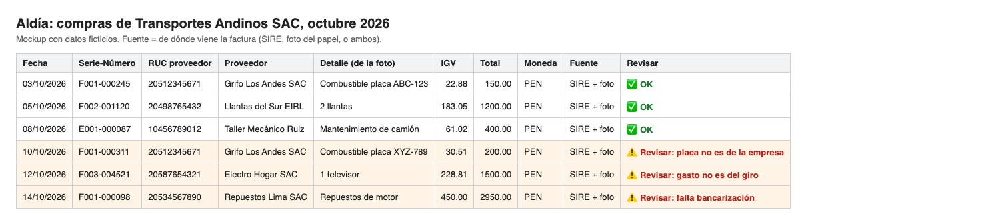

# Business idea plan

**Aldía flags doubtful invoices so accountants review only those.**

Aldia flags doubtful invoices so accountants review onnly those.

## Glossary

- **SUNAT:** Peru's tax agency.
- **IGV:** Peru's sales tax (18%).
- **Crédito fiscal (input VAT credit):** the IGV (sales tax) a company paid on its purchases, which it can subtract from the IGV it owes.
- **SIRE:** SUNAT's system where accountants download purchase and sales records.
- **CPE:** the electronic invoice.
- **RUC:** the tax ID.
- **Habido:** SUNAT found the company's address.
- **Concar:** the most used accounting software in Peru.
- **Banking channel (bancarización):** paying through a bank (not cash) when an invoice is S/ 2,000 or more. Without it, the invoice can't be used for crédito fiscal.
- **Detracción:** for some goods and services, the buyer deposits a part of the payment in the supplier's Banco de la Nación account.
- **Sujeto sin capacidad operativa:** a SUNAT list of suppliers whose invoices can't be used for crédito fiscal.
- **NRUS / RMT / RER:** tax regimes for small businesses. NRUS can't use crédito fiscal.

## My assumption

I believe accountants lose a lot of time checking invoices for crédito fiscal, and would pay for a tool that validates invoices automatically.
I'll know I'm right if 3 of 5 accountants say it costs them hours, and 3 of 5 already pay for a tool.
**Result:** I talked to 4 accountants. 75% (3 of 4) say it costs them hours, and 75% (3 of 4) already pay for a tool. My line passed.

## How my plan changed

First I thought the problem of small business owners was fear of SUNAT. Then I learned that some owners are not formal businesses, and they care more about client debts and sales. So I talked to an accountant, and I learned that their pain is checking invoices for crédito fiscal and uploading entries one by one.

## 1. Who it's for, the problem, and how they solve it today

Aldía is for accountants in Peru who check invoices by hand. They reject many invoices, and they upload entries one by one. Today they use Concar, SIRE and Excel, but validation is still manual.

**How they solve it today:**
1. The client keeps paper invoices by month.
2. The accountant downloads the SIRE .txt and converts it to Excel.
3. She checks each invoice one by one.
4. It takes about 2 hours for 50–70 invoices.

## 2. Competitors and why someone would choose my product

- **CumpliTax:** claims automatic validation with 140+ rules (vendor claim, not proven).
- **NubeCont:** accepts XML and compares with SIRE. S/ 49/month + S/ 15 per extra company.
- **ContaUno:** made for accountants with many companies (S/ 139 for up to 50). The accountant still reviews.

**Why Aldía:** Aldía flags doubtful invoices and the accountant approves them. It saves the flagged information, so when SUNAT audits, the accountant can show why each invoice was accepted. It's an add-on next to their current tool, not a replacement.

Full research: `research/Aldía_ closest competitors and adjacent tools.md` and `research/aldia_competitor_matrix.csv`.

## 3. My experiment, what I learned, and what I'm still assuming

**Experiment:**

- I talked about my idea in an auditorium at a tech event.
- I made an informative webpage with a demo and showed it at the event. Analytics: 9 visits, only 1 left their contact, plus 1 warm contact.
- I did 3 live interviews with possible users (small business owners).
- I contacted 3 business incubators. Only 1 replied: they mostly have student ideas, not running businesses registered with SUNAT.
- By message, I asked 1 entrepreneur and 1 accountant. The accountant told me they still verify data by hand.
- I talked to 3 more accountants: 1 call and 2 by voice messages.

**What I learned:**

- Fear of SUNAT is not what owners worry about most.
- Many businesses are informal, not registered with SUNAT.
- Accountants have many tools, but they still need to verify what the system does.
- 75% of accountants (3 of 4) say it costs them hours (50–70 invoices take about 2 hours, 250 invoices take 1.5–2 hours, 50–60 invoices take 2–3 hours). This part of my line passed.
- 75% (3 of 4) already pay for a tool (a Concar extension, an ERP with an accounting module at S/ 450 per month with support, and an accounting system that cost S/ 1,500 to install plus about $60 per year). This part of my line passed too.
- Most common rejection reasons (from accountants): expenses that don't match the business, fuel invoices with plates that aren't the company's vehicles (unless there's a rental contract), the supplier billing the wrong company, and currency.
- I counted the reasons in 3 transcripts: expense not for the business 3 of 3, banking channel 3 of 3, plate 2 of 3, detracción 2 of 3, wrong company 1 of 3.
- One accountant was audited. She defended invoices with extra documents: quotes, purchase orders, guías de remisión, bank payment proof for amounts above S/ 2,000, and rental contracts. So the audit record could mean linking each invoice to its proof.
- 4 owners: only 1 had a real debt (fiado) problem. Another owner's pain was expenses and petty cash not recorded.
- Most accountants don't fully trust any system. They always do a final check. But 1 accountant said she prefers the system does it alone.
- Another accountant has never been audited. Estudios contables can even earn more when a client is audited, so the "audit record" may not sell on its own. SUNAT did 9,447 determinative audit actions in 2025, so audits are rare.
- One accountant checks if the supplier is a sujeto sin capacidad operativa (a SUNAT list). Only 1 said it, but my RUC lookup could check it.
- Invoices arrive on paper: clients keep them by month. But the same accountant said most companies want everything virtual.
- New signal: matching SIRE vs. paper invoices (50 in SIRE, 25 on paper), and checking if an expense makes sense for the business.

**Still assuming:**

- Accountants would pay for it. They already pay for tools, but not yet for Aldía.
- Validation can be automated.
- OCR can read real paper invoices correctly (plate, items, serie-número, RUC). Not tested yet.
- My worry: every workflow should have a human in the loop. Maybe this validation step is that human step. Only 1 accountant said "the system alone," so I will test it.

## 4. Smallest useful version, mockup, how I'd build and test it

- **Smallest version:** Aldía alerts the accountant: "you need to review these specific invoices." It checks the 3 most common rejection reasons accountants told me: the expense is not for the business, the fuel plate is not a company vehicle (and there's no rental contract), or the invoice was not paid through a banking channel (over S/ 2,000).
- **Why banking channel and not wrong company:** 3 of 3 accountants mentioned the banking channel, and only 1 mentioned wrong company. The client can upload the bank payment voucher, so I don't need bank credentials.
- **Input:** the SIRE file the accountant already downloads, plus the photos of the invoices, the list of company plates, the giro de negocio, and the bank payment voucher the client uploads. SIRE is not enough, because SIRE doesn't show the plate or what was bought.
- **Mockup:** `aldia-mockup.png` (fake data). It needs the other columns that SIRE does not have: **Detalle** comes from the invoice, and **Fuente** shows if the invoice is in SIRE, on paper, or both, to compare SIRE vs paper.
- **Build:** by hand first (concierge MVP), with AI help: I or AI match each photo to its SIRE row by serie-número and RUC, AI applies the 3 rules, and I check every row. I check each invoice myself, to test if the idea helps before I write code. For plate I will compare the company's list of vehicle plates, for the banking channel I will check the voucher the client uploads, and for expense I will compare the client's business activity.
- **Test:** An accountant I interviewed gives me 3 invoices she rejected and 3 good ones. It works if Aldía flags all 3 rejected and none of the good ones.



**Flow** (the validation step is where people had the most opinions):

```
Accountant uploads SIRE Excel
        ↓
Aldía checks the 3 rules
        ↓
   Invoice flagged?
   │
   ├─ no  → Goes to Concar ✅
   │
   └─ yes → Accountant reviews it
                 ↓
            Approve or reject?
            │
            ├─ approve → Record saved → Goes to Concar ✅
            └─ reject  → Record saved → Back to the client ❌
```

## 5. Pricing, marketing, first paying customers

- **Price:** S/ 5 per RUC per month, cheaper than NubeCont's extra company. With ~37 clients per accountant, that's about S/ 185 per month.
- **Market:** about 1.5 million taxpayers in RMT and RER can use crédito fiscal (SUNAT 2025). NRUS can't. There are more than 63,000 registered accountants (CCPL, 2023).
- **Message:** "Aldía te ayuda a revisar solo las facturas dudosas."
- **First customers:** my accountant friends first. Then the accountants' club on the outskirts of the city, which holds events for all accountants (volleyball tournaments, dances). I'd also go to my university to talk to some teachers about the idea.
- **From trying to paying:** free first month, then S/ 5 per RUC.

## 6. What I'd test next, and what result would make me change direction

- Next test: I ask another accountant about the last 3 invoices she rejected, and why. My rules work if they catch 2 of 3.
- I'll send what the AI MVP does to my accountants, so they can try it and give me early feedback (real invoices only with their permission).
- I'll also test if accountants want a human in the loop for validation.
- If the rules fail, I change the rules first (detracción, 2 of 3).
- After the free month, 3 of 5 accountants must pay S/ 5 per RUC. If not, I stop.
- Test the new signal: is matching SIRE vs. paper a bigger pain than flagging invoices by rules?
